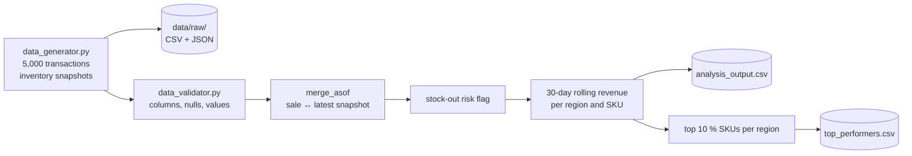

# Retail Sales & Inventory Processing (pandas)

[](https://github.com/ArturLy263/data_processing_project/actions/workflows/ci.yml)

A small pandas pipeline on **synthetic** retail data. It generates sales transactions and inventory
snapshots, joins each sale to the latest earlier stock snapshot of the same SKU (`merge_asof`),
flags stock-out risk, computes a 30-day rolling average of revenue per region and SKU, and selects
the top 10 % of SKUs by revenue in each region. Optionally, it loads the results into PostgreSQL.

Before processing, the input is validated: required columns present, no nulls, unique
`transaction_id`, positive `unit_price` and `units_sold`, non-negative `current_stock`. Invalid data
stops the run with a `DataValidationError` that names the rule and the columns.

The data is generated with fixed random seeds, so every run produces the same output. This is a
learning project on synthetic data, not a production pipeline.

## Run it

```bash
python3 -m venv .venv
source .venv/bin/activate
pip install -r requirements-dev.txt     # requirements.txt alone is enough to run the pipeline

python -m src.main                      # creates data/raw/ and data/processed/
python -m pytest tests -q
```

Tested with Python 3.12 and 3.14.

To check a run: `data/processed/analysis_output.csv` has 5,000 rows plus a header and
`data/processed/top_performers.csv` 30 rows plus a header; the first rows of `top_performers.csv`
are shown below. Running the pipeline again produces identical files.

## Load the results into PostgreSQL (optional)

```bash
docker compose up -d --wait postgres          # PostgreSQL 16 on localhost:5435
cp .env.example .env
set -a; . ./.env; set +a                       # export DATABASE_URL and TEST_DATABASE_URL

python -m src.main --load-postgres
python -m pytest tests -q                      # now also runs the database tests
```

`src/load/postgres_loader.py` creates two tables if they do not exist, `sales_analysis` (one row
per transaction, primary key `transaction_id`, CHECK constraints on price, quantity and stock) and
`top_performers` (primary key `region, item_sku`), and replaces their contents with `TRUNCATE` and
`COPY` in **one transaction**: a failed load leaves the previous results untouched, and running it
again gives the same rows. `revenue_by_region()` is an example SQL query over the loaded data:

```sql
SELECT region, COUNT(*) AS transactions, SUM(gross_revenue) AS gross_revenue,
       COUNT(*) FILTER (WHERE stockout_risk) AS stockout_risks
FROM sales_analysis GROUP BY region ORDER BY region;
```

Without `--load-postgres` the pipeline needs no database. The database tests are skipped when
`TEST_DATABASE_URL` is not set; with `REQUIRE_TEST_DATABASE=1` (as in CI) a missing database fails
the run instead. Each test works in its own temporary schema and drops it afterwards.

## Pipeline



| Step | Function | Rule |
| --- | --- | --- |
| Validation | `validate_transactions`, `validate_inventory` | see above; raises `DataValidationError` |
| As-of join | `merge_transactions_inventory` | each sale gets the most recent stock snapshot on or before its date |
| Stock-out risk | `add_stockout_risk` | units sold > 5 % of current stock |
| Rolling revenue | `add_rolling_revenue` | mean revenue over the trailing 30 days, per region and SKU |
| Top performers | `get_top_performers` | SKUs at or above the 90th revenue percentile of their region |

## Outputs

- `data/processed/analysis_output.csv` — one row per transaction with stock level, `stockout_risk`
  and `rolling_30d_avg_revenue`
- `data/processed/top_performers.csv` — `region, item_sku, gross_revenue`

First rows of `top_performers.csv`:

```text
region,item_sku,gross_revenue
Central,PROD-009,326489.44
Central,PROD-033,321532.68
Central,PROD-034,315704.64
```

## Structure

```text
src/
├── main.py                     # runs the pipeline
├── models/data_generator.py    # synthetic transactions and inventory
├── processors/analyzer.py      # join, flags, rolling revenue, top performers
├── load/postgres_loader.py     # optional load into PostgreSQL
└── validators/data_validator.py # input checks
tests/
```

## Tests

- `test_analyzer.py`: the 30-day rolling window and that top performers keep their region
- `test_pipeline.py`: the as-of join picks the latest earlier snapshot of the same SKU (and leaves
  stock empty when there is none), the 5 % stock-out threshold, and a full run of `main()` in a
  temporary directory that writes all files and produces identical output twice
- `test_data_validator.py`: each validation rule
- `test_postgres_loader.py`: tables and types after a load (including a sale with no stock
  snapshot), a repeated load, a failed load that keeps the previous rows, and the example query —
  against a real PostgreSQL

GitHub Actions starts a PostgreSQL 16 service, runs all tests with `REQUIRE_TEST_DATABASE=1`, then
runs the pipeline on a fresh checkout, with and without loading into PostgreSQL (twice, to check
that a repeated load gives the same row count).
